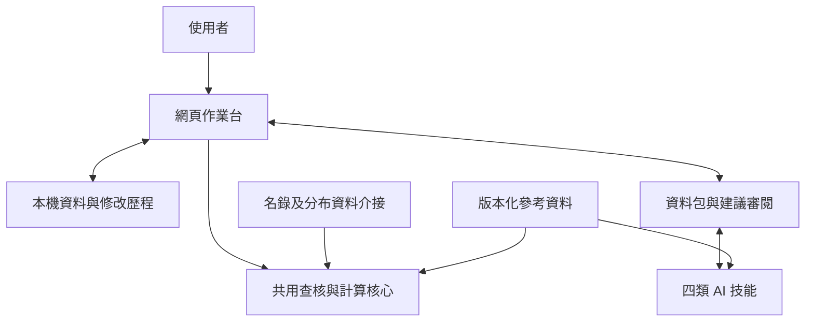

# 作業台第一版設計規格

日期：2026-11-13（Asia/Taipei）

狀態：供討論的設計文件；尚未實作網頁、資料庫、資料包或新技能。

本文件將討論中的企劃收斂為可供後續實作的設計基準。使用者已確認的決策與本輪提出的操作細節分開記錄；草圖和範例均為示意，不代表已完成的產品。

## 已確認的範圍

| 項目 | 決策 |
| --- | --- |
| 專案名稱 | `Taiwan-plant-red-list-assistant`。 |
| 主要介面 | 免安裝網頁，使用者可完全手動完成評估資料。 |
| 保存方式 | 個人清單與評估資料保存在本機瀏覽器，提供資料包匯出與還原。 |
| 分類基礎 | 使用 TaiCOL 名錄快照；允許有文獻依據的人工分類處理，保留差異與理由。 |
| 評估單位 | 種、亞種或變種，以確認後的最小適用分類群為單位。 |
| AI | 四類技能按需協助；第一版透過資料包與建議匯入交換資料，由使用者審閱後採用。 |
| 報告 | 暫不開發報告範本、排版、PDF、Word 或其他正式報告輸出；格式待計畫主事者確認。 |
| 後續工作 | 本機連接程式為選配；多人上傳、整合、互評及公開發布另行規劃。 |

流程為「建立清單 → 分類查核 → 分布資料匯入與查核 → 區內初評與區域調整 → 完整性檢查與資料包匯出」。任何階段都可儲存、備份及繼續編輯。匯出不以完成評估或通過所有科學檢查為前提。

區內初評使用評估區域內的資料套用 IUCN 準則；區外資料另用於區域調整。全球評估不列為第一版必經步驟。方法依據見 [IUCN 區域評估指引](https://s3.amazonaws.com/iucnredlist-newcms/staging/public/attachments/3154/reg_guidelines_en.pdf)。

## 地理範圍

沿用使用者確認的中華民國目前實際管轄範圍內的陸域，涵蓋臺灣本島及周邊附屬島嶼（蘭嶼、小蘭嶼、綠島、小琉球、龜山島、基隆嶼、彭佳嶼、棉花嶼、花瓶嶼等）、澎湖群島、金門群島、馬祖列島、烏坵、東沙島及太平島。

既有 [region.json](../../skills/taiwan-plant-red-list/references/region.json) 包含文字描述、查詢框與地圖定位點，尚不是經驗證的正式陸域邊界。新設計需要分開保存評估範圍、API 查詢範圍及顯示底圖。無法判定是否位於範圍內的紀錄保留待查；不能僅因國別欄位或簡化底圖未涵蓋小島就排除。

## 文件導覽

| 文件 | 內容 |
| --- | --- |
| [畫面與操作流程](workbench.md) | 清單、分類、地圖查核、準則、AI 建議與備份的文字草圖；狀態與錯誤處理。 |
| [資料與交換規格](data-contract.md) | 欄位、證據、版本、三種資料包、AI 建議格式與匯入規則。 |
| [開發與驗收清單](delivery-plan.md) | 依賴順序、交付項目、代表性案例、待驗證事項及延後範圍。 |

## 預定架構

網頁負責操作、顯示與資料保存；共用核心負責明確可定義的驗證及計算；技能負責按需搜尋、解釋與提出建議。相同計算輸入應得到相同工具結果，不因使用的模型而改變。

## 本輪建議，尚未當作已確認需求

- 以桌面瀏覽器為主要作業介面，窄畫面保留查閱與基本編輯。
- 完整備份使用 ZIP，AI 任務使用包含選定資料的 ZIP，AI 建議使用 JSON。正式副檔名與欄位名稱可在實作前調整。
- 第一版將備份還原為獨立的本機工作副本，不自動合併兩份分歧的評估。
- 將分布紀錄的證據用途與空間計算用途分開查核。
- 使用者的評估內容與 AI 待審建議分開保存；接受建議才更新評估。
- 第一版重點是清單與評估資料的操作，不另外增加 CSV、GIS 或其他獨立成品輸出；CSV／GeoJSON 資料匯入仍列入設計。

## 與現有原型的關係

目前儲存庫已有單一技能、CLI、分布資料快照、人工查核、空間計算與 Markdown 草稿輸出。它們是可評估重用的原型，並非本文件描述的網頁已完成。

本輪只新增規劃文件與 README 導覽，不修改程式或技能行為。既有 CLI 的 `report` 命令仍屬舊原型能力；新網頁第一版不提供正式報告輸出。未來重用需逐項驗證，既有使用者資料另設匯入與遷移流程。

## 尚待釐清但不阻礙閱讀草圖的事項

- 太平島、東沙、烏坵及其他小島的名錄涵蓋、邊界來源與資料授權。
- 分類拆併與種下分類的專案政策，包含尚不能歸入下位分類群的紀錄如何整理。
- 首批試評分類群及代表性資料；目前建議約 10–20 個案例。
- 實際瀏覽器相容性、API 跨來源存取、檔案大小與大量資料操作的可行性。
- 正式報告格式由計畫主事者另行確認，不作為本版交付依賴。
