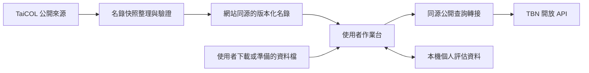

# P0 可行性查核紀錄

查核日期：2026-11-13（Asia/Taipei）。本輪執行公開資料查詢、固定版名錄欄位分析，以及獨立暫存瀏覽器的能力測試。沒有建立產品網頁、正式名錄資料庫、資料包匯入器或新技能。

## 結論與設計影響

| 項目 | 本輪證據 | 對設計的影響 |
| --- | --- | --- |
| TaiCOL 固定版物種名錄 | 已讀取 2026-10-30 ZIP，含 96,984 列，其中 11,540 列的門為 Tracheophyta。 | 可作名稱索引來源；筆數含高階分類與多種原生／外來屬性，不是待評估數。 |
| 分類父子關係 | 本次 CSV 沒有 `parent_taxon_id` 與 `higher_taxa`；即時 taxon API 有這些欄位。 | 快照建置需補分類關係；不能僅憑名稱字串展開最小單位。 |
| API 由網頁直接讀取 | Chrome 與 Edge 中，TaiCOL taxon、TBN taxon 與 occurrence 均被 CORS 阻擋。 | 純靜態網站不能依本次條件直接完成自動匯入，需要來源支援跨來源或另設公開查詢轉接。 |
| 本機保存基礎 | 兩個瀏覽器都能將虛構資料寫入 IndexedDB，重新載入頁面後一致讀回。 | 本機保存的基本能力可行；尚未驗證產品的完整保存與恢復流程。 |
| 本機檔案交換基礎 | JSON Blob 建立與讀回成功；有下載屬性支援。 | 支援資料包方向，但 ZIP 備份、實際磁碟下載與跨裝置還原尚未測試。 |
| 分類展開邊界 | 皿柱蘭屬回傳已刪除項、非台灣標記項，以及有下位單位的母種。 | 候選預覽需展示篩選過程、保留排除項與母種覆蓋待查。 |
| 空間品質欄位 | 兩筆 TBN 樣本同時標示已模糊化、不確定性數值 0。 | 不可單憑 0 推定精確座標；多個品質欄位需合併判讀。 |

這些是局部可行性證據。地理邊界、全名錄關係完整性、各島嶼涵蓋、正式資料遷移、效能及完整備份均仍待驗證，P0 不標示為全部完成。

## 1. TaiCOL 名錄與欄位

來源為 [TaiCOL 下載頁](https://taicol.tw/zh-hant/download) 列出的 [物種檔案 2026-10-30](https://taicol.tw/static/upload/TaiCOL_taxon_20261030.zip)。本輪只在暫存位置讀取，未將整份名錄加入專案。

- ZIP 大小為 5,845,336 bytes；內含 CSV 大小為 36,026,787 bytes。
- SHA-256 為 `549e829adad3e5e75240331cb1eb4afe7c2888192187d9d69a9bf9dbbcff135b`。
- 共 96,984 列；Plantae 為 15,617 列，Tracheophyta 為 11,540 列。
- Tracheophyta 中的 Species、Subspecies、Variety 分別為 7,834、129、715 列，合計 8,678 列。尚未處理原生／野生適用性、上下位重疊與分類概念，不能稱為 8,678 個評估單位。
- CSV 提供 taxon ID、name ID、名稱、異名、誤用名與科屬等階層名稱，但沒有父分類群 ID。API 的父子關係需另外取得。

來源 API 的 [公開文件](https://taicol.tw/zh-hant/api) 說明 taxon API 有父階層與較高階層資料，分頁上限為 300；`including_not_official` 預設包含尚未經正式紀錄的資料。nameMatch 的比對名錄可能與即時網站不同步。這些狀態與版本需要保留，不能視為一致的即時名錄。

建議名錄處理分成固定版名稱資料、固定版分類關係、名稱使用／來源對照三部分。若用即時 API 補充下載版缺少的關係，需記錄各自版本與取得時段，處理相同 ID 的名稱或概念差異，再發布新的組合快照；不可將不同時點資料宣稱為同一個官方版本。

公開 API 文件標示「政府資料開放授權條款」，網站文字政策則預設為 CC BY 4.0。建立來源目錄時需按資源分別記錄，下載檔與其他文件也要核對個別說明。[網站政策](https://taicol.tw/zh-hant/policy)

統計、欄位及查詢摘要見 [來源查核資料](evidence/2026-11-13-source-probe.json)。

## 2. 皿柱蘭屬的展開示例

本輪以 `taxon_group=Lecanorchis&limit=300` 查詢，得到 28 筆且應用層狀態為成功。以下僅展示候選篩選，不替代新版地理範圍與分類概念的人工確認。

| 步驟 | 筆數 | 說明 |
| --- | --- | --- |
| 原始回傳 | 28 | 包含屬、種、變種及已刪除的舊項目。 |
| 接受名項目 | 20 | 另有 8 筆 `taxon_status=deleted`，保留供歷史對照。 |
| 接受名且來源標記存在於台灣 | 19 | 此來源標記尚不等同新版所有島嶼的完整適用性。 |
| 種／亞種／變種階層 | 18 | 排除屬的整理項。 |
| 扣除有下位候選的 3 個母種 | 15 | 得到機械展開的末端候選，仍需覆蓋查核。 |

本次資料中，Lecanorchis multiflora 有三個變種、L. nigricans 有兩個變種，而 L. purpurea 只有一個所列下位變種 L. purpurea var. actinomorpha。這只能說明名錄中的父子關係，不能直接推論母種所有概念或紀錄已被該變種涵蓋。

因此新增以下設計要求：

1. 母種保留整理頁與未歸屬紀錄；不因存在下位單位而丟棄資料。
2. 保留種下涵蓋狀態、判斷理由與證據。未確認完整涵蓋時，提示使用者查核。
3. 不自動創造原名變種，不將母種紀錄自動指派給唯一或原名變種。
4. 來源標記不在台灣的項目仍可查看；新版離島範圍未釐清前不以該旗標作不可逆排除。
5. 已刪除與接受中的相同名稱可有不同 taxon ID；保留來源狀態，不能只依學名去重。

精簡分類來源記錄見 [屬級查核資料](evidence/2026-11-13-taicol-genus-probe.json)。此資料整理自 TaiCOL 公開 API，保留查詢與日期供引註；不含個人資料或分布座標。

## 3. TBN 介接樣本

以 [TBN v2.6](https://www.tbn.org.tw/data/api/v26) 查詢臺灣杉分類群，再取 occurrence 的兩筆資料檢查形狀。服務當時回報總數 767；本輪只取兩筆，不是完整下載或族群調查。下一頁使用 `links.next`，包含 `minID`，不應自行假設固定頁碼。

兩筆品質樣本的 `dataGeneralizations` 都為 true，`coordinateUncertaintyInMeters` 都為 0，其中一筆基準未知，另一筆為 WGS84，野生程度皆為不確定。故不將數值 0 當成精確定位證明。原始日期、地名、資料集與來源資訊仍可作其他證據；是否適合 AOO／EOO 必須另外查核。

原始紀錄中有授權欄位，不能只套用 API 說明的授權標籤。設計保存 API 使用條款與每筆／每資料集的原有授權。查核摘要只保存欄位品質與分頁資訊，未收錄座標、觀測者資訊、媒體或完整原始紀錄。

## 4. 瀏覽器測試方法與限制

在 Windows 上使用 Chrome 157 與 Edge 157，各以新的暫存設定目錄執行無視窗測試。測試頁只在回送位址提供，沒有讀取既有使用者瀏覽器設定、評估資料或登入資訊，也沒有關閉瀏覽器跨來源或憑證保護。

測試先寫入虛構 IndexedDB 資料，再重新載入頁面比對；接著檢查 Blob 讀回與儲存 API，最後以一般 `fetch`、`mode=cors`、`credentials=omit` 存取以下來源。

| 查詢 | Chrome | Edge |
| --- | --- | --- |
| 測試頁自己的 JSON 控制組 | 可讀取 | 可讀取 |
| GBIF 公開分類查詢控制組 | 可跨來源讀取 | 可跨來源讀取 |
| TaiCOL taxon | 缺少允許來源標頭，CORS 阻擋 | 同左 |
| TBN taxon | 缺少允許來源標頭，CORS 阻擋 | 同左 |
| TBN occurrence | 缺少允許來源標頭，CORS 阻擋 | 同左 |

詳細結果包含 origin、User-Agent 與瀏覽器錯誤訊息，見 [瀏覽器查核資料](evidence/2026-11-13-browser-probe.json)。這是本次測試環境與受測網址的結果，不是所有正式部署來源的永久保證；上線前仍需用預定網址再測。

兩個瀏覽器的 `persisted()` 均為 false，代表測試當下未取得持續儲存狀態。重新載入可讀回不代表資料永久保留。此次也未測試瀏覽器完全退出重開、實際下載、ZIP、跨裝置、配額耗盡或多頁籤衝突。[儲存配額與清除機制](https://developer.mozilla.org/en-US/docs/Web/API/Storage_API/Storage_quotas_and_eviction_criteria)

一般工具能以系統信任連線讀取 API，並不表示網頁可讀其回覆。工具本身的憑證或網路環境失敗也需與來源服務故障區分，不拿單一工具失敗作來源停機結論。

## 5. 資料取得架構的建議修訂

建議採以下分工，仍待實作設計確認；本輪沒有建立或部署轉接服務。

- TaiCOL 基本比對使用事先整理的靜態名錄，不讓每位使用者逐頁下載完整名錄。
- TBN 的即時匯入經由同源、唯讀的公開查詢轉接。輸入只包含公開分類群／查詢條件與分頁資訊；個人評估內容、私人附件、人工座標與備註不送往轉接服務。
- 轉接限制來源、路徑與參數，驗證下一頁連結，保留上游錯誤與部分下載狀態，不成為任意網址代理。
- 公開查詢服務不建立個人評估資料庫。部署時仍需確認主機平台的存取紀錄、快取與保留政策，不能在未查核前宣稱完全沒有伺服器紀錄。
- 若暫不提供轉接，保留檔案匯入，並可增加 TBN 原始 JSON／快照匯入；此路徑不能宣稱具備網頁一鍵自動下載。
- 不以關閉瀏覽器保護或 `no-cors` 作解法；後者不能讓程式讀取受限回覆。

這項修訂不改變本機保存原則，但代表「公開網頁＋即時 TBN 自動匯入」不能在目前已測條件下只靠完全靜態託管。正式部署平台與轉接實作方式留待下一階段選定。

## 6. 後續待驗證

- 各指定島嶼的名錄涵蓋、陸域邊界與授權。
- 分類快照的父子關係完整性、刪除／合併對照、異名使用與跨版本一致性。
- 預定網站來源的 CORS、轉接服務、完整分頁與故障恢復。
- 名錄查詢及大量紀錄在瀏覽器的效能與配額。
- 真正的資料包匯出、附件、雜湊、還原與格式遷移。
- 首批實際評估分類群的分類、分布與方法專家覆核。
