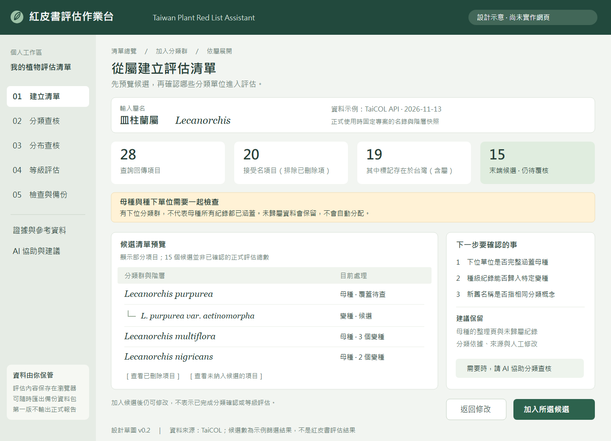

# 首輪試評與驗證情境

日期：2026-11-13。以下是 12 個建議驗證情境，不是已完成的評估、正式物種清單或受脅等級建議。區分已取得的來源樣本與尚待建立的案例，不把設計驗收寫成通過紀錄。

## 操作草圖

[可縮放的 SVG 草圖](assets/list-preview.svg)。數字來自本輪皿柱蘭屬查詢及明示的篩選示例，按鈕與工作狀態皆為設計示意。正式名錄快照與產品網頁尚未建立。

建議先由「預覽候選 → 查核母種與下位單位 → 加入所選項目」試走。候選名單可以先加入並保留待查，無須先解決每一個分類爭議；但不能將尚未確定的種級紀錄自動分派到某個變種。

## 情境與預期行為

| 編號 | 材料／輸入 | 要驗證的行為 | 目前狀態 |
| --- | --- | --- | --- |
| P01 屬級展開 | Lecanorchis 查詢回傳 28 筆 | 分開已刪除項、接受名、來源台灣旗標、高階整理項與末端候選，展示篩選數量。 | 已取得公開分類樣本；網頁未實作。 |
| P02 種下涵蓋 | L. purpurea 與其所列變種 L. purpurea var. actinomorpha | 顯示種下涵蓋待查，保留母種整理頁與未歸屬紀錄；不自創原名變種。 | 已確認樣本中的父子關係；未完成科學分類覆核。 |
| P03 同名舊新項 | L. nigricans 的已刪除與接受項目、其變種 | 同名不直接合併；保留 taxon ID、來源狀態與版本，歷史紀錄待確認歸屬。 | 已取得公開分類樣本。 |
| P04 種與亞種 | Ipomoea pes-caprae、I. pes-caprae subsp. brasiliensis | 由來源階層建立評估單位，不以名稱截斷或唯一候選推定原始紀錄歸屬。 | 固定版名錄找到兩項；完整父子關係快照待建。 |
| P05 模糊化紀錄 | 臺灣杉的兩筆 TBN 品質樣本 | 分開「可作證據」與「可作空間計算」；0 不確定性不能蓋過已模糊化旗標。 | 已查核兩筆的欄位形狀；未完整匯入。 |
| P06 不同植物類群 | Selaginella tamariscina、Pteris vittata、Asplenium nidus、Ficus microcarpa 等候選 | 覆蓋不同類群、名稱與欄位；確認相同工作流程不侷限裸子植物。 | 名稱已在固定版名錄找到；分布與適用性待查。 |
| P07 小島與區界 | 合成的本島及各離島地名／座標情境 | 所有指定島嶼有入口；邊界不明保留待查；來源國別不直接決定區域歸屬。 | 案例與可靠邊界待建立。 |
| P08 歷史與低精度 | 合成的歷史標本、只有地名與模糊座標 | 保留歷史證據與定位精度，不自動視為現存或捏造精確座標。 | 案例待建立。 |
| P09 下載與重複 | 合成的分頁中斷、零筆、錯誤與跨平台重複 | 部分下載不標完整；同座標不等於重複；應用層錯誤不當成零筆。 | 已觀察 TBN 的下一頁形式；故障情境待建。 |
| P10 準則缺漏 | 合成的低 AOO 與未知其他 B 條件 | 顯示證據缺口，不自動完成 B、不把未知轉為否或 LC。 | 規則測試案例待建。 |
| P11 AI 審閱 | 任務版本 4、之後人工修改、含相依證據的建議 | 有效建議待審；過期、缺來源與重複提案不直接寫入；獨立建議可逐項接受。 | 已有格式示例；匯入器未實作。 |
| P12 保存與還原 | 虛構含中文、空值、附件及歷程的評估 | 未完成也可備份；完整還原新副本；配額不足與不同版本不靜默遺失資料。 | 僅 IndexedDB 頁面重載與 Blob 基礎測試通過；完整備份未測。 |

P06 只作試用候選，不推定它們的族群狀態、資料品質或特定島嶼分布。正式的約 10–20 個試評分類群，可在看到各類群的紀錄完整性後再決定，不為湊足數量提前作科學判斷。

## 一次人工試走的紀錄方式

每次記錄案例編號、資料版本、使用者要完成的任務、實際步驟、卡住的位置、是否需要外部資料，以及最後保存的狀態。資料來源問題、科學判斷問題與介面操作問題分開記錄，避免把來源缺漏誤當軟體失敗。

首輪先驗證一個分類群從清單到保存與備份的完整流程，再對分類拆併、敏感紀錄、離島與資料不足情境擴充。使用者全程可以略過 AI；AI 任務用相同資料另行驗證。

## 來源與限制

- 分類樣本來自 [TaiCOL 下載頁](https://taicol.tw/zh-hant/download) 及 [TaiCOL API](https://taicol.tw/zh-hant/api)，原始識別碼與取得時間見 [查核紀錄](feasibility.md)。
- 分布品質樣本來自 [TBN API v2.6](https://www.tbn.org.tw/data/api/v26)，此專案只保存不含座標的品質摘要。
- P07–P12 的合成案例不能作為真實評估證據，也不能冒充 IUCN 官方考題。
